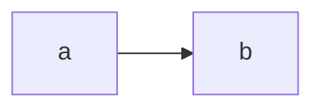

# E2E Fence Showcase

Every built-in fence, then two wikilinks: [[fence-target]] and [[no-such-doc]].



```hive-tree
root: web/packages/ui/src
files:
  - path: lib/githubMarkdown.ts
    status: modified
    note: split on any registered fence
  - path: components/CanvasMermaid.vue
    status: deleted
```

```hive-calls
name: CanvasMarkdown.parts
at: web/packages/ui/src/components/CanvasMarkdown.vue:22
kind: computed
calls:
  - name: renderCanvasMarkdown
    at: web/packages/ui/src/lib/githubMarkdown.ts:280
    note: isFence decides the split
```

```hive-forge
snapshot: 2026-11-22T12:30
items:
  - kind: issue
    ref: colonyops/hive#864
    url: https://github.com/colonyops/hive/issues/864
    title: "A review comment on a mermaid diagram loses its anchor"
    state: open
```
