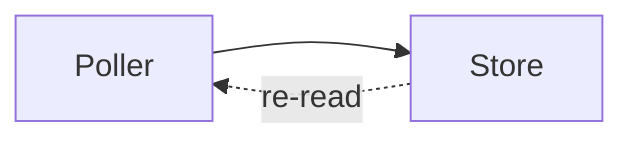

# Hive Drive

The `hive-drive` MCP server is an agent's output surface. Its tools put
documents in front of the user, in a pane beside the conversation, in a chat
or in a Code session, while the session keeps running. It is the difference
between describing a plan in terminal scrollback and handing the user one to
read (ADR canvases-are-named-files-in-the-workspace-folder-served-over-their-own-mcp-entry).

Like `hive-desktop`, the server is the running app itself: nothing to
install, nothing to fetch. It is a separate entry so a workspace can have the
drive without granting the app-control tool set, and the other way around.
`hive-canvas` is the same server at its older address.

## Spaces and the session argument

Hive Drive is one folder tree under hive's context directory, split into
spaces. A space is a repository (`owner/repo`), a Chats workspace
(`workspaces/<name>`), or the one `shared` space. Every tool works inside the
space of the caller, and every tool takes a `session` that names the caller.
It is one of three things:

- In a Hive chat it is the `HIVE_AGENT_SESSION` environment variable, which
  Hive sets in the launched process. The space is the chat's workspace, so
  every chat of a workspace sees the same documents. A chat launched before
  the variable existed does not have it until it is relaunched.
- Anywhere else it is the absolute path of your working directory. Hive finds
  the hive session whose checkout holds it, and the space is that session's
  repository: the folder the checkout links as `.hive`. Every session of a
  repository sees the same documents, and nothing is written into the
  checkout itself.
- Outside a chat and a hive session it is the word `global`, and the space is
  `shared`. A directory inside no hive session is `not_found`, not global:
  pass `global` yourself. The shared space has no pane, so `open_document`,
  `open_canvas` and `close_canvas` refuse it; the user reads it in the drive
  view.

## Paths and kinds

A path is relative to the space root, with forward slashes, no empty segment,
no segment that starts with a dot, and nothing that climbs out with `..`.
The empty path is the space root, which only `list_documents` takes.

What a document is follows from its name:

- **markdown**, `.md`: GitHub-flavored markdown, optionally opening with
  YAML front matter.
- **html**, `.html`: a page of its own, shown in a sandboxed frame. Inline
  styles and scripts run; anything else loads only over `https` or as a
  `data:` URL, and forms and frames do not work. It is not sanitized the way
  a canvas html block is, and the `hv-` classes below do not apply to it.
- **canvas**, `.canvas.json`: an ordered list of blocks that you edit one
  block at a time with the canvas tools.
- **file**: anything else in the folder. Hive lists it and leaves it alone.

Folders are created as needed when you write, so file a plan as
`plans/auth-rewrite.md` without making `plans/` first. Name documents by
artifact (`release-notes`, `perf-report`), not by conversation: they outlive
the chat or session that made them, and other agents and the user read the
same tree. List before you write over something you did not make.

## Front matter

A markdown document may open with YAML front matter between two `---` lines.
`title` is the name the user sees in the tree; any other keys are yours.
`write_document` refuses front matter that does not parse, and front matter
that does not close within the first 8 KiB, rather than saving a document
Hive would show without its title. Hive does not add or change anything in a
markdown document's front matter.

A canvas carries editable front matter too, set with `set_frontmatter`. Keys
use letters, digits, dots, hyphens, or underscores. Values are strings,
finite numbers, booleans, null, or flat lists of those scalar values. `tags`
is conventionally a list of strings. `set_frontmatter` replaces the complete
editable mapping, so read the canvas first when preserving fields another
agent wrote, and pass an empty object to remove every editable field. Hive
owns `created_at` and `updated_at`, updates them with the canvas, and refuses
either key in the tool. Copy and save include all of them in a YAML header.

## Document tools

- `list_documents`: a folder's entries, folders first. Each entry has a
  `kind` (`dir`, `markdown`, `html`, `canvas`, `file`), `path`, `name`,
  `title`, `size`, `modified`, and `front` for markdown and canvas. `detail`
  defaults to `children`, one level down; `tree` returns the whole subtree.
  The answer names the `space` and echoes the `detail` it used. A missing
  folder is `not_found`.
- `read_document`: one markdown or html document, its entry plus `body`
  exactly as stored. A canvas is read with `read_canvas`.
- `write_document`: create or replace a whole `.md` or `.html` document,
  up to 2 MiB. A `.canvas.json` path is refused; write canvases with the
  canvas tools. Answers with the entry as stored.
- `move_document`: rename or move a document, a canvas, or a folder inside
  the space. The target must not exist, and a document keeps its extension.
  Answers with the entry at its new path.
- `delete_document`: delete a document, a canvas, or an empty folder, and
  answer with the path deleted. There is no recursive delete and no trash.
- `open_document`: ask to open the pane beside this chat or session, showing
  the document at `path` when you give one. It must exist.

The pane does not open by itself: a write while it is closed lights an unseen
dot on its toggle. Open it when something is finished and worth reading, not
on every write. Opening is best-effort: it applies only while the user is
viewing this chat or session, and there is no acknowledgment either way.

## Canvases

A canvas is a document of blocks you revise in place. Blocks are:

- **markdown**: a title (optional) and a body, rendered as GitHub-flavored
  markdown. Raw HTML in the body is escaped, not rendered. A standalone
  `mermaid` fence renders as a diagram that follows the app theme.
- **html**: a title (optional) and a body of markup, for layout markdown
  cannot express: a row of stat tiles, a two-column comparison, a card grid,
  or a drawn diagram. See [Writing an html block](#writing-an-html-block).
- **link**: a title and an `http`, `https`, or `mailto` URL, shown as an
  openable link.

Block ids are yours: reusing an id updates that block in place, which is how
a status line is revised instead of duplicated, and a `before` anchor places
or moves a block ahead of an existing one.

A canvas is addressed by name or by path. A bare name like `perf` files at
`canvases/perf.canvas.json`. A name with folders files where it says:
`reports/2026-10/perf` is `reports/2026-10/perf.canvas.json`, and the folders
are created on the first write. The last segment is short, lowercase and
filename-like. `list_canvases` answers each canvas by the name the other
canvas tools take.

The canvas tools:

- `put_block`: create or replace one block; the first write under a new name
  creates that canvas. Answers with the canvas metadata and the stored block,
  never the whole surface.
- `put_blocks`: write a batch of blocks in one atomic call, for laying out a
  canvas whole instead of block by block.
- `remove_block`: remove one block by id.
- `set_frontmatter`: replace the complete editable front matter mapping.
- `clear_canvas`: remove every block; the canvas, its name and title survive.
- `delete_canvas`: remove a canvas entirely.
- `read_canvas`: read one canvas exactly as the user sees it, every block in
  order.
- `list_canvases`: every canvas in the space, including ones earlier chats
  made, most recently updated first.
- `open_canvas` / `close_canvas`: ask to show or hide the pane, optionally
  pinned to one canvas. They follow the same rules as `open_document`.

## Writing a Mermaid diagram

Put a standalone `mermaid` fence inside a markdown block:

````markdown

````

Hive renders diagrams with Mermaid's strict security mode. Diagram scripts,
HTML labels and interactive links stay disabled. A diagram that does not parse
shows an error in place without breaking the surrounding markdown. Theme
changes redraw the diagram with the current canvas colours.

Each diagram sits in a pan-and-zoom viewport. Drag to pan, use the controls to
zoom or fit the whole diagram, or hold Control/Command while scrolling to zoom
around the pointer.

Copy and save preserve the source fence, so Markdown viewers with Mermaid
support can render the exported diagram too.

## Writing an html block

How a block looks is yours. Any class, any `style` attribute, any colour or
size — nothing in the allowlist is second-guessed, and a block renders inside
the pane it was written for, so it cannot paint over the rest of the app.

What a block may **reach** is not yours: no script, no event handler, no
embedded document, and links only to `http`, `https` or `mailto`. A write that
uses one of those fails and names it, rather than rendering something you
believe is intact.

Reach for the `hv-` classes below before you invent styling. They are what
Hive styles for you: pick one and the block follows the user's theme, in light
and dark, now and after a restyle, and two canvases written months apart still
look like the same product. Write your own colours when the block needs
something the vocabulary has no name for, and remember the user may be in
either theme.

### Tags

Sectioning and text (`div`, `section`, `article`, `header`, `footer`, `aside`,
`figure`, `figcaption`, `h1`, `h2`, `h3`, `h4`, `h5`, `h6`, `p`, `span`,
`strong`, `em`, `b`, `i`, `u`, `s`, `small`, `mark`, `sub`, `sup`, `abbr`,
`q`, `time`, `br`, `hr`, `blockquote`), lists (`ul`, `ol`, `li`, `dl`, `dt`,
`dd`), code (`pre`, `code`, `kbd`, `samp`, `var`), tables (`table`, `thead`,
`tbody`, `tfoot`, `tr`, `th`, `td`, `caption`, `colgroup`, `col`), disclosure
(`details`, `summary`), `a` with an `http`, `https` or `mailto` href, and the
drawing tags in [Diagrams](#diagrams).

Also `img`, with an `http`, `https` or base64 `data:` image source. Note that
the app fetches whatever host you name, from the user's machine, every time
the canvas is opened.

Refused: `script`, `style` (the element — the `style` attribute is fine),
`iframe`, `object`, `embed`, `form` and form controls, every `on*` handler,
and `id`, which can shadow a global in the app's own page.

Attributes are `class`, `style`, `title`, `lang`, `dir`, `href` on `a`, `src`
and `alt` on `img`, `colspan`/`rowspan` and `scope` on cells, `open` on
`details`, and the drawing attributes in [Diagrams](#diagrams).

### Classes

**Layout** — `hv-stack` (vertical, evenly spaced), `hv-row` (horizontal,
wraps), `hv-grid` with one of `hv-cols-2`, `hv-cols-3`, `hv-cols-4`, `hv-cols-5`,
`hv-cols-6` (equal columns; they collapse to one when the pane is narrow, and
five or six drop to three first, so pick for the content, not for a width you
cannot see).

**Containers** — `hv-card` (a bordered, raised box: one unit of content),
`hv-panel` (a flat tinted region: a grouped aside), `hv-callout` (a
left-ruled block for something the reader must not miss).

**Data** — `hv-stat-card` is one figure tile: it holds an `hv-stat-value`, an
`hv-stat-label`, and optionally an `hv-stat-sub` (a secondary line: "0 of 2",
"confirmed on main"). Put an `hv-stat-unit` inside the value for a unit smaller
than the figure ("125 days"). The label always renders above the figure,
whatever order you write the parts in. A tone on the card colours the figure and its
border; reserve one for the number that needs attention. `hv-stat` is the
same layout without the card chrome or tone, for a figure inside a container
of your own. `hv-kv` on a `<dl>` lays its `<dt>`/`<dd>` pairs out as an aligned
key/value table.

**Emphasis** — `hv-badge` (an inline pill), `hv-muted` (de-emphasised text),
`hv-mono` (monospace, for ids, shas and figures).

**Tones**, for `hv-callout`, `hv-badge`, `hv-stat-card` and the diagram roles — `hv-info`,
`hv-success`, `hv-warn`, `hv-error`, `hv-accent`. Without one, each is
neutral.

### Diagrams

Prose and boxes cannot say which node feeds which, or which path is a return
path. Draw that as an `svg`: you place the geometry, Hive picks the size and
every colour, exactly as it does for the classes above.

Give the `svg` a `viewBox` and it scales to whatever width the user dragged
the pane to, which is usually what you want. State a `width` and `height`
instead and it keeps that size, up to the width of the pane.

The role classes below are defaults, not rules. An unclassed shape still
follows the theme; a `fill` or `stroke` attribute, or a `style`, overrides
whatever the app would have picked.

**Tags** — `svg`, `g` (a group, to move or tone several shapes at once),
`path`, `rect`, `circle`, `ellipse`, `line`, `polyline`, `polygon`, `text`
and `tspan`. There is no `defs`, `marker` or `use`: draw an arrowhead as a
`polygon`.

**Attributes** — the geometry (`viewBox`, `transform`, `d`, `points`, `x`,
`y`, `dx`, `dy`, `width`, `height`, `rx`, `ry`, `cx`, `cy`, `r`, `x1`, `y1`,
`x2`, `y2`, `preserveAspectRatio`) and the paint (`fill`, `stroke`,
`stroke-width`, `stroke-dasharray`, `stroke-linecap`, `stroke-linejoin`,
`opacity`, `fill-opacity`, `stroke-opacity`, `fill-rule`, `paint-order`,
`vector-effect`, `font-size`, `font-family`, `font-weight`, `font-style`,
`letter-spacing`, `text-anchor`, `dominant-baseline`).

**Roles** — `hv-node` (a filled, bordered shape: one box in the diagram),
`hv-edge` (a stroked connector), `hv-arrow` (a filled arrowhead or any other
solid mark), `hv-label` (text the reader reads first), and `hv-dashed`
alongside `hv-edge` for a path that is conditional, asynchronous, or a read
rather than a write. A tone on the element — or on a `g` around a whole path
— colours it; `hv-muted` and `hv-mono` work on `text` exactly as they do on a
`span`.

### Worked examples

A row of stat tiles:

```html
<div class="hv-grid hv-cols-4">
  <div class="hv-stat-card">
    <span class="hv-stat-value">1,284</span>
    <span class="hv-stat-label">Requests</span>
  </div>
  <div class="hv-stat-card">
    <span class="hv-stat-value">412<span class="hv-stat-unit">ms</span></span>
    <span class="hv-stat-sub">was 530ms last week</span>
    <span class="hv-stat-label">p95</span>
  </div>
  <div class="hv-stat-card hv-success">
    <span class="hv-stat-value">2</span>
    <span class="hv-stat-sub">of 2 approvals</span>
    <span class="hv-stat-label">Reviews</span>
  </div>
  <div class="hv-stat-card hv-error">
    <span class="hv-stat-value">1<span class="hv-stat-unit">critical</span></span>
    <span class="hv-stat-sub">confirmed on main</span>
    <span class="hv-stat-label">Unpatched</span>
  </div>
</div>
```

A before/after comparison, and a status line:

```html
<div class="hv-grid hv-cols-2">
  <section class="hv-panel">
    <h3>Before</h3>
    <p class="hv-mono">412ms</p>
  </section>
  <section class="hv-panel">
    <h3>After</h3>
    <p class="hv-mono">96ms</p>
  </section>
</div>
<p class="hv-row">
  <span class="hv-badge hv-success">passing</span>
  <span class="hv-badge hv-warn">2 flaky</span>
  <span class="hv-muted">last run 4m ago</span>
</p>
```

Facts, and something the reader must not miss:

```html
<dl class="hv-kv">
  <dt>Branch</dt><dd class="hv-mono">feat/canvas-html</dd>
  <dt>Base</dt><dd class="hv-mono">main</dd>
  <dt>Reviewer</dt><dd>unassigned</dd>
</dl>
<div class="hv-callout hv-error">
  <strong>Migration 0042 is not reversible.</strong>
  Take a backup before deploying.
</div>
```

A pipeline with a return path:

```html
<svg viewBox="0 0 300 120">
  <g class="hv-accent">
    <rect class="hv-node" x="4" y="10" width="90" height="40" rx="7" />
    <text class="hv-label" x="49" y="35" text-anchor="middle">Poller</text>
  </g>
  <rect class="hv-node" x="150" y="10" width="90" height="40" rx="7" />
  <text class="hv-label" x="195" y="35" text-anchor="middle">Store</text>

  <line class="hv-edge" x1="94" y1="30" x2="140" y2="30" />
  <polygon class="hv-arrow" points="140,26 149,30 140,34" />

  <path class="hv-edge hv-dashed" d="M195 50 L195 90 L49 90 L49 50" />
  <polygon class="hv-arrow" points="45,58 49,50 53,58" />
  <text class="hv-muted" x="122" y="105" text-anchor="middle">re-read on wake</text>
</svg>
```

An html block is exported as its markup, so a canvas saved to a file keeps the
structure and loses the styling — the `hv-` names mean nothing outside Hive,
and a drawing that leans on them falls back to svg's own defaults, which are
black boxes and no edges. What you write inline survives: a `style`, a `fill`,
a `stroke`. Style a diagram yourself when the canvas is meant to leave the
app. Reach for `markdown` for prose and `html` only when the layout is the
point.

## Launch

Hive reaches it over Streamable HTTP on the loopback server that also hosts
the webhook listener:

```
http://127.0.0.1:<port>/mcp/drive
```

The same server answers at `/mcp/canvas`, the address of the `hive-canvas`
entry, so an agent configured for that keeps working.

The port is allocated at startup, so this entry carries **no URL in the
registry**: the live address is resolved when the catalogue is rendered
(`Descriptor.RuntimeURL`), and the catalogue reports a problem instead when
the loopback server is disabled. The first allocated port is written to
`settings.yaml` as `http.port`, so the address stays the same across
restarts.

A workspace that lists `hive-drive` gets this address in its generated MCP
configuration. Any other agent, such as the one a hive session runs, reaches
the same server once the user adds the address to that agent's own MCP
configuration. Hive never edits an agent's configuration outside a workspace.

The server requires no token. It sits behind the loopback bind, spawns no
processes, and writes only inside the caller's space under hive's context
directory.
