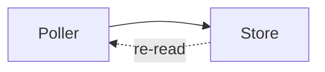

# Hive Drive

The `hive-drive` MCP server is an agent's output surface. Its tools put
documents in front of the user, in the Drive tab of a chat or a Code
session, while the session keeps running. It is the difference
between describing a plan in terminal scrollback and handing the user one to
read (ADR hive-drive-is-one-document-tree-under-the-context-root-and-a-canvas-is-one-document-kind-in-it).

Like `hive-desktop`, the server is the running app itself: nothing to
install, nothing to fetch. It is a separate entry so a workspace can have the
drive without granting the app-control tool set, and the other way around.

## Spaces and the caller argument

Hive Drive is one folder tree under hive's context directory, split into
spaces. A space is a repository (`owner/repo`), a Chats workspace
(`workspaces/<name>`), or the one `shared` space. Every tool works inside the
space of the caller, and every tool takes a `caller` that names the caller.
It is one of three things:

- In a Hive chat it is the `HIVE_AGENT_SESSION` environment variable, which
  Hive sets in the launched process. The space is the chat's workspace, so
  every chat of a workspace sees the same documents. A chat launched before
  the variable existed does not have it until it is relaunched.
- Anywhere else it is the absolute path of your working directory. Hive finds
  the hive session whose checkout holds it, and the space is that session's
  repository: the folder the checkout links as `.hive`. Every session of a
  repository sees the same documents, and nothing is written into the
  checkout itself.
- Outside a chat and a hive session it is the word `global`, and the space is
  `shared`. A directory inside no hive session is `not_found`, not global:
  pass `global` yourself. The shared space sits beside no chat or session and has
  no tabs, so `tab_open` and `tab_close` refuse it; the user reads it in the
  Drive page.

## Paths and kinds

A path is relative to the space root, with forward slashes, no empty segment,
no segment that starts with a dot, and nothing that climbs out with `..`.
The empty path is the space root, which only `document_list` takes.

What a document is follows from its name:

- **markdown**, `.md`: GitHub-flavored markdown, optionally opening with
  YAML front matter. Raw HTML in the body is escaped, not rendered.
- **html**, `.html`: a page of its own, shown in a sandboxed frame. Inline
  styles and scripts run. Scripts, styles and fetches load only over `https`;
  images, fonts and media load over `https` or as a `data:` URL. Forms and
  frames do not work. A `#fragment` link scrolls the page; a relative link
  does nothing, so link to other documents from markdown.
- **file**: anything else in the folder. Hive lists it and leaves it alone,
  and `document_get` reads it when it is UTF-8 text.

Folders are created as needed when you write, so file a plan as
`plans/auth-rewrite.md` without making `plans/` first. Name documents by
artifact (`release-notes`, `perf-report`), not by conversation: they outlive
the chat or session that made them, and other agents and the user read the
same tree. List before you write over something you did not make.

## Front matter

A markdown document may open with YAML front matter between two `---` lines.
`title` is the name the user sees in the tree; any other keys are yours.
`document_put` refuses front matter that does not parse, and front matter
that does not close within the first 8 KiB, rather than saving a document
Hive would show without its title. Hive does not add or change anything in a
markdown document's front matter.

## Document tools

- `document_list`: a folder's entries, folders first. Each entry has a
  `kind` (`dir`, `markdown`, `html`, `file`), `path`, `name`,
  `title`, `size`, `modified`, and `front` for markdown. `detail`
  defaults to `children`, one level down; `tree` returns the whole subtree.
  The answer names the `space` and echoes the `detail` it used. A missing
  folder is `not_found`.
- `document_get`: one markdown or html document, or any other UTF-8 text
  file, its entry plus `body` exactly as stored. A binary file is refused.
- `document_put`: create or replace a whole `.md` or `.html` document,
  up to 2 MiB. Answers with the entry as stored.
- `document_move`: rename or move a document or a folder inside
  the space. The target must not exist, and a document keeps its extension.
  Answers with the entry at its new path.
- `document_delete`: delete a document or an empty folder, and
  answer with the path deleted. There is no recursive delete and no trash.

A write while a Drive tab is open behind another tab lights a dot on that tab.
With no Drive tab open, a write shows nothing until the user opens Drive, so
call `tab_open` when something is finished and worth reading now, not on every
write.

## Tabs and layout

Drive, Diff, Tasks and terminals open as tabs in panels beside a chat or Code
session. A panel holds tabs, and a split joins two panels side by side or
stacked. You can do with the layout what the user can. Every call below is a
request to the app: the tab change applies only while the user is viewing this
chat or session, and there is no acknowledgment. The tmux side of `terminal`
is the exception: `tab_open` starts or finds the window and `tab_close` kills
it whether or not the session is on screen.

A tab reference names one tab, in a `tab` or `anchor` input:

- `drive`, `diff` or `tasks` name that view. A chat has only `drive`.
- `terminal` names a chat's one terminal.
- `applet:<id>` names an applet's tab. `tab_open` opens it if the applet's
  `applet.yaml` lists `surfaces.tab`, which runs its page, and `tab_close` ends
  it.
- Anything else is a tmux window of a Code session, by id (`@3`) or exact
  name. A Code session must name its window; `terminal` alone is refused.

The tools:

- `tab_open`: open the tab for a `view` (`drive`, `diff`, `tasks`, `terminal`
  or `applet:<id>`). `path`, for `drive`, is a document by its path in the
  space; it must exist, and a folder is refused. `placement` is `behind` (the default; behind
  a tab, with an unseen dot, never takes the screen), `beside` (a split to the
  right) or `below` (a split downward). `anchor` is the tab to place relative
  to; omit it for the tab in front of the focused panel. A tab that is already
  open stays where it is. The answer names the `view`, the resolved `path` and,
  for `terminal`, the `window` id.
- `tab_close`: close the tab for `drive`, `diff` or `tasks`. Documents are
  untouched. `terminal` needs `window` and kills that tmux window
  and what runs in it; only close a window you started. A chat's terminal is
  the chat, so it is refused.
- `tab_move`: move `tab`. `placement` `behind` puts it in the anchor's panel
  right after the anchor, or at the end of the focused panel with no anchor.
  `beside` and `below` split the anchor's panel (or the focused one) and move
  the tab into the new panel.
- `tab_focus`: bring `tab` forward and focus its panel. A window is also
  selected in tmux, by the app and only while the session is on screen.
- `panel_close`: close the panel that holds `tab`. Its tabs join the
  neighbouring panel, and the last panel stays.
- `split_resize`: give the side that holds `tab` a `share` of its nearest
  split, from 0.2 to 0.8.
- `split_turn`: turn the nearest split of `tab` between side by side and
  stacked.
- `layout_get`: read the layout the app last reported: `panels` with their
  `tabs` (each spelled the way the tools take it, with `kind`, the window
  `name` for a Code session, and `shown` for the panel's front tab),
  `focusedPanel`, `splits` (`axis` `row` is side by side, `column` is
  stacked; `first` and `second` are panel or split ids), and `onScreen`. When
  `known` is `false` the app has not reported this layout yet, for instance
  just after it started or when the session has never been open in Code; act
  without it.

Call `layout_get` first when you are not sure what is open. Layout changes may
land after the call returns, so read again before you build on one.

`tab_focus` and `tab_close` on a terminal are the two that take something from
the user: the first takes the screen, the second ends a running process. Use
`tab_focus` when the user asked to see something, not to show off a result;
for a result use `tab_open`, which leaves the focus where it is. Close only a
window you started.

A `terminal` opens detached, so it never takes the keyboard or the screen. A
new one is a shell in the session's checkout with nothing running in it: the
tool takes no command, so run your own work yourself and open a terminal for
the user to type in. The session must be running; start it in Code first. Two
inputs apply to `tab_open` with `terminal` only, and either with another view
is refused:

- `name`: the name of the new window.
- `window`: an existing window of the session, by tmux id (`@3`) or exact
  window name. It is placed instead of starting one, so it excludes `name`. A
  window the session does not have is `not_found`.

## Diff reviews

When the user asks you to review a Code session's changes, write the review
with these tools instead of pasting it into the terminal. The Diff view draws
each comment under the lines it is about. The user dismisses the ones they
disagree with, can reply to one with context, and Send delivers the rest to the
session's agent with their own comments. The user's replies to a comment reach
the session's agent inside that comment, in order; they do not come back
through `diff_review_get`. A review is about the branch
against its base, the Branch comparison, which is what a pull request shows.

- `diff_review_put`: store your review: a `summary` and `comments`. In a hive
  session it reviews your own session; in a chat, name one in `sessionId`, by
  id or name from `session_list`. Each comment has a `path`, `text`, a
  `severity` (`issue`, `suggestion` by default, or `note`), and either
  `startLine` and `endLine` or `kind` `file` for the whole file. Lines count
  as the branch has them; with `startSide` `deletions` they count as the base
  had them, for a removed line. Hive quotes the rows itself. Set `agent` to
  `claude`, `codex` or `pi` so the view draws your mark. A second review from
  the same `author` replaces the first, so send the whole review each time.
- `diff_review_get`: the reviews still waiting. A comment the user dismissed or
  sent is gone from it.
- `diff_review_clear`: withdraw your review, or every review of the session.

Every comment must name a file in the branch diff, and a lines comment must
name rows the diff shows: changed lines or the context around them. Read the
diff with `git diff $(git merge-base HEAD origin/<base>)` in the checkout to
get the numbers right. A refused review lists every comment to fix and stores
nothing. Keep each comment to one actionable point and put the overview in
`summary`. When the review is stored, open the `diff` tab with `tab_open`.

## Writing a Mermaid diagram

Put a standalone `mermaid` fence in a markdown document:

````markdown

````

Hive renders diagrams with Mermaid's strict security mode. Diagram scripts,
HTML labels and interactive links stay disabled. A diagram that does not parse
shows an error in place without breaking the surrounding markdown. Theme
changes redraw the diagram with the current theme colours.

Each diagram sits in a pan-and-zoom viewport. Drag to pan, use the controls to
zoom or fit the whole diagram, or hold Control/Command while scrolling to zoom
around the pointer.

Copy and save preserve the source fence, so Markdown viewers with Mermaid
support can render the exported diagram too.

## Launch

Hive reaches it over Streamable HTTP on the loopback server that also hosts
the webhook listener:

```text
http://127.0.0.1:<port>/mcp/drive
```

The port is allocated at startup, so this entry carries **no URL in the
registry**: the live address is resolved when the catalogue is rendered
(`Descriptor.RuntimeURL`), and the catalogue reports a problem instead when
the loopback server is disabled. The first allocated port is written to
`settings.yaml` as `http.port`, so the address stays the same across
restarts.

A workspace that lists `hive-drive` gets this server in its generated MCP
configuration. When the `hive` command (`daemon.hive_path`, else the
login-shell PATH) reports the same version as the app, the entry is a stdio
server, `hive --data-dir <dir> mcp serve --toolset drive,layout`. It finds
the app through its endpoint file on every call and fills `caller` itself, so
the entry holds no port and the agent passes no caller. Otherwise the entry is
the HTTP address above. Any other agent, such as the one a hive session runs,
gets the same entry when the user presses Add in Settings ▸ MCP servers; Hive
edits an agent's own configuration only then.

The HTTP server requires no token. It sits behind the loopback bind, runs no
command a caller writes, and writes only inside the caller's space under
hive's context directory.
